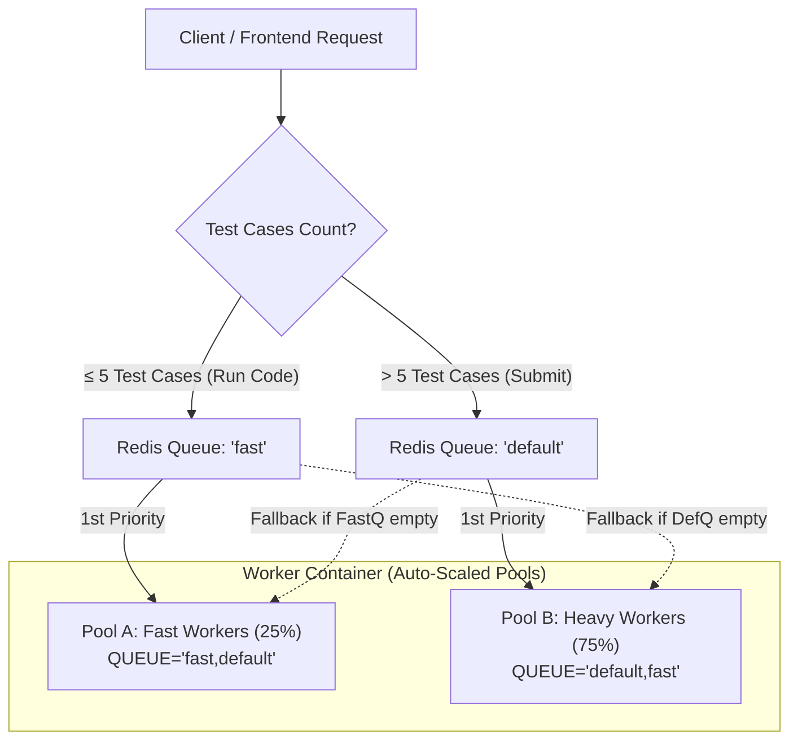

# Implementation Plan: Intelligent Dual-Tier Priority Queuing in Judge0

This plan specifies the architecture, file changes, formulas, and verification strategy for adding **Dual-Tier Priority Queuing** (`fast` vs. `default`) with **Bidirectional Fallback Work-Stealing**.

> [!IMPORTANT]
> **Isolation Guarantee:** Per user requirement, the main production image (`iwillpinchu/judge0-four:v2-cgroup`) and the production files (`Dockerfile.four-languages`, `docker-compose.four-languages.yml`) will **NOT** be modified. All changes will be encapsulated in a dedicated image (`iwillpinchu/judge0-four:v2-priority-queues`) and dedicated companion configuration files.

---

## 1. System Architecture & Queue Mechanics



### Core Design Rules
1. **Dynamic Queue Routing:**
   - Suites with $\le 5$ test cases are enqueued to `fast`.
   - Suites with $> 5$ test cases are enqueued to `default`.
   - Single submissions (`/submissions`) default to `fast`.
2. **Bidirectional Work-Stealing:**
   - Pool A listens to `fast,default` (drains fast first, steals heavy work if idle).
   - Pool B listens to `default,fast` (drains heavy first, steals fast work if idle).
   - **Zero wasted workers:** 100% capacity is utilized regardless of traffic distribution.
3. **Mathematical Core-Allocation Formula:**
   For any core count $N$ and total workers $T = 2 \times N$:
   $$\text{FAST\_COUNT} = \begin{cases} 1 & \text{if } T \le 1 \\ \max\left(1, \left\lfloor \frac{T}{4} \right\rfloor\right) & \text{if } T \ge 2 \end{cases}$$
   $$\text{DEFAULT\_COUNT} = \begin{cases} 0 & \text{if } T \le 1 \\ T - \text{FAST\_COUNT} & \text{if } T \ge 2 \end{cases}$$

---

## 2. File-by-File Implementation Plan

### File 1: `app/controllers/suites_controller.rb`
* **Current State:** Hardcoded to default queue via `SuiteJob.perform_later(suite.id)`.
* **Changes:**
  - Inspect `suite.suite_test_cases.size` (or incoming `test_cases` parameter).
  - Dynamically set target queue:
    ```ruby
    target_queue = suite.suite_test_cases.size <= 5 ? :fast : :default
    SuiteJob.set(queue: target_queue).perform_later(suite.id)
    ```
* **Verify:** Check Redis queue key `resque:queue:fast` vs `resque:queue:default` via `redis-cli keys *`.

---

### File 2: `app/controllers/submissions_controller.rb`
* **Current State:** Legacy submissions and batch creations push to `ENV["JUDGE0_VERSION"]`.
* **Changes:**
  - Route single test submissions directly to `:fast`.
  - In `batch_create`, dynamically route:
    - If `submissions.size <= Config::FAST_QUEUE_THRESHOLD` $\implies$ route items to `:fast`.
    - If `submissions.size > Config::FAST_QUEUE_THRESHOLD` $\implies$ route items to `:default` (prevents large batches from monopolizing the interactive queue).
  - Update `check_queue_size` to sum across all active queues: `Resque.queues.sum { |q| Resque.size(q) rescue 0 }`.
* **Verify:** Verify small batch enters `:fast` and large batch enters `:default`.

---

### File 3: `scripts/workers-priority` (New Script)
Create a new worker launcher that implements the dynamic formula and launches both worker pools under a single process supervisor:

```bash
#!/bin/bash
source ./scripts/load-config
export | sudo tee /api/environment

date_now() {
    echo -n $(date +"%Y-%m-%d-%H-%M-%S")
}

TOTAL_WORKERS=${COUNT:-$(( $(nproc) * 2 ))}

if [ "$TOTAL_WORKERS" -le 1 ]; then
    FAST_COUNT=1
    DEFAULT_COUNT=0
else
    FAST_COUNT=$(( TOTAL_WORKERS / 4 ))
    [ "$FAST_COUNT" -lt 1 ] && FAST_COUNT=1
    DEFAULT_COUNT=$(( TOTAL_WORKERS - FAST_COUNT ))
fi

echo "[$(date_now)] Starting Intelligent Worker Pools:"
echo "  - Total Capacity : ${TOTAL_WORKERS} workers"
echo "  - Fast Pool      : ${FAST_COUNT} workers (QUEUE=fast,default)"
echo "  - Heavy Pool     : ${DEFAULT_COUNT} workers (QUEUE=default,fast)"

run_resque=1
resque_fast_pid=0
resque_default_pid=0
scheduler_pid=0

exit_gracefully() {
    echo "[$(date_now)] Gracefully terminating worker pools..."
    run_resque=0
    [ "$resque_fast_pid" -gt 0 ] && kill -SIGQUIT $(pgrep -P $resque_fast_pid) 2>/dev/null && kill -SIGTERM $resque_fast_pid 2>/dev/null
    [ "$resque_default_pid" -gt 0 ] && kill -SIGQUIT $(pgrep -P $resque_default_pid) 2>/dev/null && kill -SIGTERM $resque_default_pid 2>/dev/null
    kill -SIGTERM $scheduler_pid 2>/dev/null
}

trap exit_gracefully SIGTERM SIGINT

mkdir -p tmp/pids &> /dev/null
while [[ $run_resque -eq 1 ]]; do
    if ! kill -0 $scheduler_pid 2>/dev/null; then
        rake resque:scheduler &
        scheduler_pid=$!
    fi

    # Launch Fast Pool
    if [ "$FAST_COUNT" -gt 0 ] && ! kill -0 $resque_fast_pid 2>/dev/null; then
        QUEUE="fast,default" COUNT=$FAST_COUNT rails resque:workers &
        resque_fast_pid=$!
    fi

    # Launch Heavy Pool
    if [ "$DEFAULT_COUNT" -gt 0 ] && ! kill -0 $resque_default_pid 2>/dev/null; then
        QUEUE="default,fast" COUNT=$DEFAULT_COUNT rails resque:workers &
        resque_default_pid=$!
    fi

    sleep 2s
done
```

---

### File 4: `Dockerfile.priority-queues` (New Separate Dockerfile)
* **Base:** `ARG COMPILER_IMAGE=iwillpinchu/judge0-compilers-four:v2-cgroup`
* **Output Image:** `iwillpinchu/judge0-four:v2-priority-queues`
* Inherits the clean Debian 12 Bookworm build without modifying `Dockerfile.four-languages`.

---

### File 5: `docker-compose.priority-queues.yml` (New Separate Compose Stack)
```yaml
services:
  server:
    image: iwillpinchu/judge0-four:v2-priority-queues
    volumes:
      - ./judge0.four-languages.conf:/judge0.conf:ro
    ports:
      - "2358:2358"
    privileged: true
    environment:
      - JUDGE0_LEAN_MODE=true
    restart: always
    depends_on:
      - db
      - redis

  worker:
    image: iwillpinchu/judge0-four:v2-priority-queues
    command: ["./scripts/workers-priority"]
    volumes:
      - ./judge0.four-languages.conf:/judge0.conf:ro
    privileged: true
    environment:
      - JUDGE0_LEAN_MODE=true
    restart: always
    depends_on:
      - db
      - redis
```

---

## 3. Verification & Benchmark Protocol

A dedicated verification script (`judge0-tests/tests/test-priority-queuing.js`) will be created to validate:

1. **Routing Accuracy:**
   - 2-test case suite lands in `resque:queue:fast`.
   - 20-test case suite lands in `resque:queue:default`.
2. **Starvation Resistance Under Flood:**
   - Background thread fires 50 heavy 50-test-case suites.
   - Foreground thread fires single 3-test-case "Run Code" request.
   - **Success Criteria:** 3-test-case run completes in $< 500\text{ ms}$, bypassing the queue backlog.
3. **Zero Waste Verification:**
   - Stop submitting `fast` jobs.
   - Verify all 24 workers actively pick up `default` jobs.

---

## 4. Execution Steps

1. Create `scripts/workers-priority` with permission executable (`100755`).
2. Add dynamic routing in `app/controllers/suites_controller.rb` and `app/controllers/submissions_controller.rb`.
3. Create `Dockerfile.priority-queues` and `docker-compose.priority-queues.yml`.
4. Build `iwillpinchu/judge0-four:v2-priority-queues` and test the stack locally.
5. Run the priority verification test and benchmark results.

---

## 5. Verification & Status

### Test Run Results (Against `v2-priority-queues`)
- **Total Tests Executed:** 29
- **Passed:** 29 (100%)
- **Failed:** 0

| Test Module | Passed | Total | Rate | Notes |
| :--- | :---: | :---: | :---: | :--- |
| **Wait Parameter (Sync/Async)** | 4 | 4 | 100% | Synchronous and asynchronous suites |
| **Base64 Encoding Modes** | 3 | 3 | 100% | Base64 true, false, and omitted |
| **Field Filtering & Validation** | 4 | 4 | 100% | Field slicing and invalid field handling |
| **Languages (C, C++, Java, Python)** | 5 | 5 | 100% | All 4 compilers & runtimes |
| **Security Hardening (0555 & Sandbox)** | 2 | 2 | 100% | Inter-test-case file isolation & binary write lock |
| **Edge Cases & Crash Isolation** | 5 | 5 | 100% | SIGSEGV, TLE, and Java exceptions isolated |
| **Intelligent Priority Queuing** | 6 | 6 | 100% | Threshold, single, small/large suites, batch, /workers |

### Git & Image Segregation
- **Dedicated Branch:** `feat/intelligent-priority-queuing` (pushed to `myfork`)
- **Priority Image:** `iwillpinchu/judge0-four:v2-priority-queues`
- **Main Production Image:** `iwillpinchu/judge0-four:v2-cgroup` (completely untouched)
- **Main Compose Stack:** `docker-compose.four-languages.yml` (completely untouched)

