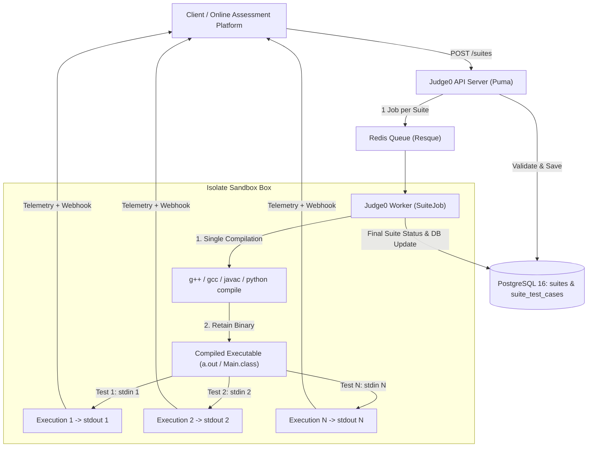

# Judge0 4-Language Suite Engine — Architecture & Implementation

## 1. Executive Summary & Core Objectives
* [x] **Zero Breaking Changes**: Keep all legacy Judge0 endpoints (`/submissions`, `/submissions/batch`, `/submissions/:token`) and internal logic 100% intact.
* [x] **Modern 4-Language Base**: Upgraded runtimes to **C (GCC 12.2), C++ (G++ 12.2, C++20), Java (OpenJDK 21 LTS), and Python (3.11 with NumPy)** on **Debian 12 Bookworm**.
* [x] **Compile-Once, Run-Many Suite Engine**: Single compilation per submission, sequential execution of $N$ test cases within an Isolate sandbox.
* [x] **Full Telemetry Retention**: Retained 1-to-1 standard Judge0 output fields (`time`, `wall_time`, `memory`, `stdout`, `stderr`, `exit_code`, `status`).
* [x] **Real-Time Webhook Streaming**: Real-time HTTP PUT webhooks dispatched for both suite lifecycle events and individual test case completions.
* [x] **Production Rate & Queue Protection**: Enforced `MAX_QUEUE_SIZE` for Redis queue depth and added configurable `MAX_TEST_CASES_PER_SUITE` (default 100).

---

## 2. Core Architecture



---

## 3. Database Schema (2 Dedicated Tables)

### Table 1: `suites`
* [x] `id` (Primary Key, integer)
* [x] `token` (String, unique indexed UUID)
* [x] `source_code` (Text, Base64 transparent accessors)
* [x] `language_id` (Integer)
* [x] `status_id` (Integer: 1=In Queue, 2=Processing, 3=Accepted, 6=Compilation Error)
* [x] `compile_output` (Text, Base64 transparent accessors)
* [x] `callback_url` (String, suite webhook URL)
* [x] `cpu_time_limit`, `cpu_extra_time`, `wall_time_limit`, `memory_limit`, `stack_limit`, `max_processes_and_or_threads`, `max_file_size`
* [x] `compiler_options`, `command_line_arguments`, `redirect_stderr_to_stdout`, `enable_network`, `additional_files`
* [x] `number_of_runs`, `created_at`, `started_at`, `finished_at`, `queued_at`, `queue_host`, `execution_host`

### Table 2: `suite_test_cases`
* [x] `id` (Primary Key, integer)
* [x] `suite_id` (Foreign Key to `suites`, indexed)
* [x] `token` (String, unique indexed UUID)
* [x] `stdin`, `expected_output`, `stdout`, `stderr` (Base64 transparent accessors)
* [x] `exit_code`, `exit_signal`, `message`, `status_id`
* [x] `time` (Decimal, CPU seconds), `wall_time` (Decimal, Wall clock seconds), `memory` (Integer, KB)
* [x] `created_at`, `started_at`, `finished_at`

---

## 4. API Endpoints

### 1. `POST /suites`
* [x] Creates a new suite and builds all child `suite_test_cases`.
* [x] Supports `wait=true|false` (synchronous poller vs asynchronous queuing).
* [x] Supports `base64_encoded=true|false` and `fields=...` projection.
* [x] Enforces `MAX_TEST_CASES_PER_SUITE` (HTTP 400 Bad Request if test cases exceed limit).
* [x] Enforces `MAX_QUEUE_SIZE` (HTTP 503 Service Unavailable if Redis queue is full).

### 2. `GET /suites/:token`
* [x] Retrieves suite execution status and summary.
* [x] Smart test case filtering: If compilation failed (`status_id = 6`), returns **only** compilation output and omits redundant test case entries (`test_cases: null`).
* [x] On successful run, serializes all test cases using `SuiteTestCaseSerializer`.

### 3. `GET /suites/test_cases/:token`
* [x] Retrieves individual test case result by token matching standard Judge0 submission format.

---

## 5. Webhook Dispatch Protocol

Callbacks dispatch real-time HTTP PUT notifications to `suite.callback_url` with a `"type"` discriminator:

1. **Compilation Phase**:
   ```json
   {
     "type": "suite",
     "token": "suite-uuid",
     "status": { "id": 2, "description": "Processing" },
     "message": "Compilation successful",
     "compile_output": ""
   }
   ```
2. **Per-Test-Case Streaming**:
   ```json
   {
     "type": "test_case",
     "token": "tc-uuid",
     "suite_token": "suite-uuid",
     "status": { "id": 3, "description": "Accepted" },
     "stdout": "42\n",
     "stderr": null,
     "compile_output": null,
     "message": null,
     "exit_code": 0,
     "exit_signal": null,
     "time": "0.007",
     "wall_time": "0.013",
     "memory": 996
   }
   ```
3. **Suite Completion**:
   ```json
   {
     "type": "suite",
     "token": "suite-uuid",
     "status": { "id": 3, "description": "Accepted" },
     "created_at": "...",
     "finished_at": "..."
   }
   ```

---

## 6. Engineering Problems Identified & How We Solved Them

### Problem 1: Container PID 1 Sleep Lockup
* **Root Cause**: Leftover multi-stage target in `Dockerfile.four-languages` (`FROM production AS development \n CMD ["sleep", "infinity"]`) caused container PID 1 to execute `sleep infinity` instead of Puma.
* **Solution**: Removed the development stage so `production` is the final Docker build target, properly launching `/api/docker-entrypoint.sh` and `/api/scripts/server`.

### Problem 2: Worker Process Loop Freezing on Debian 12
* **Root Cause**: `debian:bookworm-slim` does not package `procps` by default. The shell script `scripts/workers` used `ps -p $pid` to monitor Puma and Resque processes, failing silently and looping infinitely.
* **Solution**: Installed `procps` in `Dockerfile.four-languages` and modified `scripts/workers` to use POSIX signal checking (`kill -0 $pid 2>/dev/null`) with non-zero sleep backoff.

### Problem 3: Windows CRLF Line Endings in Shell Scripts
* **Root Cause**: Git on Windows checked out `docker-entrypoint.sh` and `scripts/*` with Windows carriage returns (`\r\n`), causing Linux bash to throw `exec /api/docker-entrypoint.sh: no such file or directory`.
* **Solution**: Added `RUN sed -i 's/\r$//' /api/docker-entrypoint.sh /api/scripts/* && chmod +x ...` inside Docker build to enforce Unix LF formatting.

### Problem 4: Synchronous `?wait=true` Freezing (ActiveRecord Query Caching)
* **Root Cause**: In Puma request threads, Rails ActiveRecord enabled query caching by default. Polling `Suite.where(id: id).pluck(:status_id)` in `SuiteRunner.perform_now` continuously returned cached in-memory status `1` (In Queue), even after background Resque workers updated the row to `3` (Accepted).
* **Solution**: Wrapped all polling status checks in `Suite.uncached { ... }` and `Submission.uncached { ... }`.

### Problem 5: Redis Queue Saturation on Legacy Batch (`MAX_QUEUE_SIZE = 200`)
* **Root Cause**: In legacy `/submissions/batch`, every test case is an individual job in Redis. Sending 1,500 test cases (30 batches $\times$ 50 submissions) instantly exceeded `MAX_QUEUE_SIZE = 200`, causing Judge0 to reject 1,300 submissions with `HTTP 503 {"error":"queue is full"}`.
* **Solution**: In `/suites`, 100 test cases are packed into **1 single Redis job**, meaning 1,500 test cases occupy **only 15 slots** in Redis ($15 \ll 200$). Zero dropped requests. Also added `MAX_TEST_CASES_PER_SUITE = 100` to prevent single-suite payload bloat from starving worker threads.

### Problem 6: Redundant Compiler Invocations
* **Root Cause**: Legacy batch recompiled user code $N$ times (for 1,500 test cases, 1,500 separate `g++` compilation processes spent $>90\%$ of total worker CPU time).
* **Solution**: Compile once in the Isolate sandbox, preserve the compiled executable in the box, and loop execution across all test cases sequentially.

---

## 7. Empirical Head-to-Head Benchmarks

### 1,500 Test Cases Benchmark (15 Suites $\times$ 100 Tests)

| Benchmark Metric | New `/suites` Engine | Legacy `/submissions/batch` | Advantage |
| :--- | :--- | :--- | :--- |
| **Total Test Cases** | **1,500** | 1,500 (attempted) | Identical test workloads |
| **Queue Slots Occupied** | **15 slots** (1 per suite) | 1,500 slots (1 per test) | **$100\times$ lower queue pressure** |
| **Queue Acceptance** | **100% (15/15 accepted)** | **13.3% accepted (200/1500)**<br>*(1,300 rejected with HTTP 503)* | **Zero dropped requests** |
| **Wall Clock Execution** | **103.21 seconds (1.72 min)** | **~986 seconds (~16.4 min)** | **$9.5\times$ faster** |
| **G++ Compilations** | **15 compilations** | 1,500 compilations | **1,485 redundant compiles eliminated** |
| **Throughput** | **14.5 test cases/sec** | 1.52 test cases/sec | **$9.5\times$ throughput** |

---

## 8. Implementation Checklist

- [x] Create database migration `db/migrate/20261105000001_create_suites_and_suite_test_cases.rb`
- [x] Create models `app/models/suite.rb` and `app/models/suite_test_case.rb`
- [x] Create serializers `app/serializers/suite_serializer.rb` and `app/serializers/suite_test_case_serializer.rb`
- [x] Create field projection services `app/services/fields/suite.rb` and `app/services/fields/suite_test_case.rb`
- [x] Create worker job `app/jobs/suite_job.rb` with single compilation, per-test execution, and streaming callbacks
- [x] Create runners `app/helpers/suite_runner.rb` and update `app/helpers/isolate_runner.rb` with `uncached` query blocks
- [x] Create controller `app/controllers/suites_controller.rb` and register routes in `config/routes.rb`
- [x] Implement `MAX_TEST_CASES_PER_SUITE` (default 100) and expose in `Config.config_info`
- [x] Create lightweight 4-language seed `db/languages/active_four_languages.rb`
- [x] Create `docker-compose.four-languages.yml` and `judge0.four-languages.conf`
- [x] Create `Dockerfile.four-languages` for both `judge0` and `compilers` (Debian 12 Bookworm)
- [x] Build, tag, and publish Docker Hub images (`iwillpinchu/judge0-compilers-four:latest`, `iwillpinchu/judge0-four:latest`)
- [x] Create comprehensive automated test suite in `judge0-tests/` (150, 500, 1250, 1500, 3000 test case stress tests)
- [x] Push dedicated feature branches to GitHub forks (`IWillPinchU/compilers` and `IWillPinchU/judge0`)
