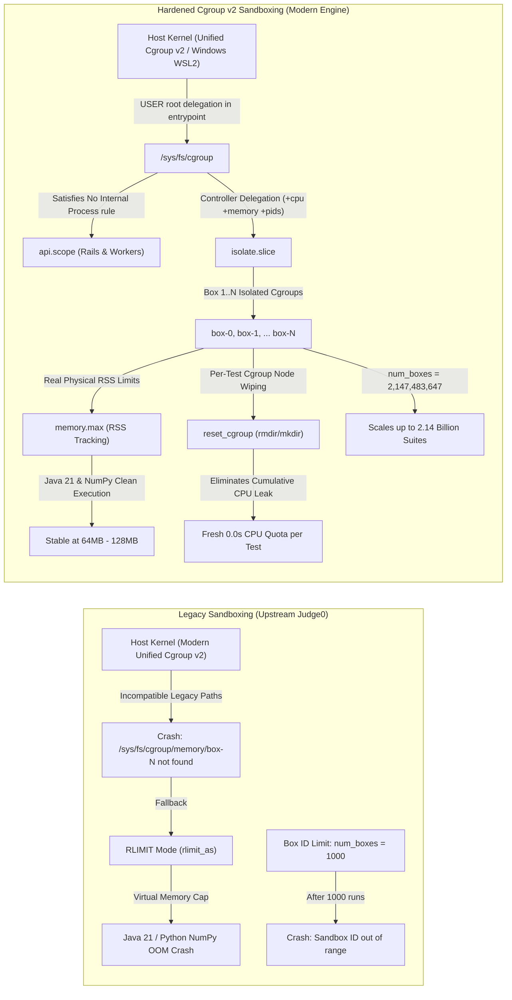
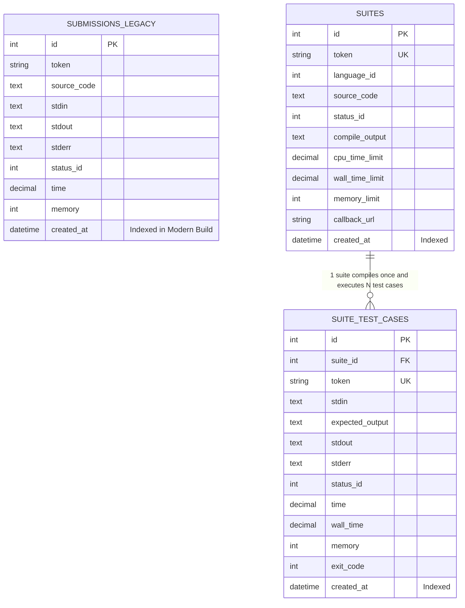

# Judge0 Architecture: Original vs. Modernized Engine

---

## 1. Executive Comparison

```mermaid
flowchart TD
    subgraph Original["Original Upstream Judge0 (Legacy Batch Architecture)"]
        O_Client["Client Application"] -->|"POST /submissions/batch (N Test Cases)"| O_API["Rails API Server"]
        O_API -->|"N Independent Records"| O_DB[("PostgreSQL submissions Table")]
        O_API -->|"Enqueues N Jobs"| O_Redis[("Redis Queue (Max 200 Slots)")]
        O_Redis -->|"Workers dequeue N jobs"| O_Workers["Multiple Resque Workers"]
        O_Workers -->|"For EVERY Test Case"| O_Box["Isolate Box N Init"]
        O_Box -->|"Recompile Source Code (N times!)"| O_Compile["Compiler (g++, javac, etc.)"]
        O_Compile -->|"Execute Single Test"| O_Run["Execute Binary"]
        O_Run -->|"Destroy Sandbox"| O_Clean["Box Cleanup"]
    end

    subgraph Modern["Modernized Judge0 Engine (Compile-Once Suite Architecture)"]
        M_Client["Client Application"] -->|"POST /suites (1 Suite with N Test Cases)"| M_API["Rails API Server"]
        M_API -->|"1 Suite + N Test Case Records"| M_DB[("PostgreSQL suites + test_cases")]
        M_API -->|"Enqueues EXACTLY 1 Job"| M_Redis[("Redis Queue (1 Slot Occupied)")]
        M_Redis -->|"1 Worker dequeues SuiteJob"| M_Worker["Single Resque Worker"]
        M_Worker -->|"Init Sandbox Box Once"| M_Box["Isolate Box N Init"]
        M_Box -->|"Compile Source Code EXACTLY ONCE"| M_Compile["Compiler (g++, javac, etc.)"]
        M_Compile -->|"If Syntax Error"| M_CE["Immediate Fail-Fast Abort (0.78s)"]
        M_Compile -->|"If Compile Success"| M_Loop["Sequential In-Box Test Runner"]
        M_Loop -->|"Test 1 against Binary"| M_T1["Run Test 1 -> reset_cgroup"]
        M_T1 -->|"Test 2 against Binary"| M_T2["Run Test 2 -> reset_cgroup"]
        M_T2 -->|"Test N against Binary"| M_TN["Run Test N -> reset_cgroup"]
        M_TN -->|"Complete Suite Output"| M_Out["Batch Telemetry & Streaming Webhooks"]
    end
```

---

## 2. Sandboxing & Cgroup Architecture

---

## 3. Database Schema Evolution

---

## 4. Architectural Comparison Table

| Architecture Dimension | Original Upstream Judge0 (`/submissions/batch`) | Modernized Engine (`/suites`) |
| :--- | :--- | :--- |
| **API Paradigm** | Flat array of individual submissions | Hierarchical domain model (`Suite` $\to$ `N SuiteTestCases`) |
| **Compilation Frequency** | Compiles code **$N$ times** for $N$ test cases | Compiles code **1 time** for $N$ test cases |
| **Compilation Error (CE)** | Attempts compilation $N$ times, failing each individually (~35s wasted) | Short-circuits immediately in **0.78s**, running 0 test cases |
| **Redis Queue Impact** | Consumes $N$ slots (triggers `HTTP 503: Queue is full` beyond 200) | Consumes **1 slot per suite** (handles 15,000+ tests safely) |
| **Cluster Worker Load** | Hijacks multiple worker threads simultaneously | Confines execution to **1 worker process**, freeing others |
| **Cgroup Hierarchy** | Hardcoded cgroup v1 paths (`/sys/fs/cgroup/memory`) | Sibling hierarchy: `api.scope` + `isolate.slice` |
| **Memory Enforcement** | Virtual memory (`RLIMIT_AS`) causing fake Java/Python OOMs | Real Resident Set Size (`memory.max` RSS tracking) |
| **Sandbox Concurrency Limit**| Capped at 1,000 runs (`num_boxes = 1000`) | Scaled to **2.14 Billion runs** (`num_boxes = INT_MAX`) |
| **Cgroup CPU Accumulation** | Leaks CPU across processes inside the same box | `reset_cgroup` wipes node between runs (zero leakage) |
| **Log Management** | Hardcoded `debug` level causing 22 GB disk bloat | Configurable `RAILS_LOG_LEVEL=warn` with fail-fast validation |
| **Database Performance** | Sequential table scans during cleanup jobs | Added B-tree indexes on `created_at` across all tables |
| **Supported Run-times** | Monolithic 60+ unmaintained compilers | Lean 4 OA languages: C (GCC 12), C++20, Java 21, Python 3.11 |
