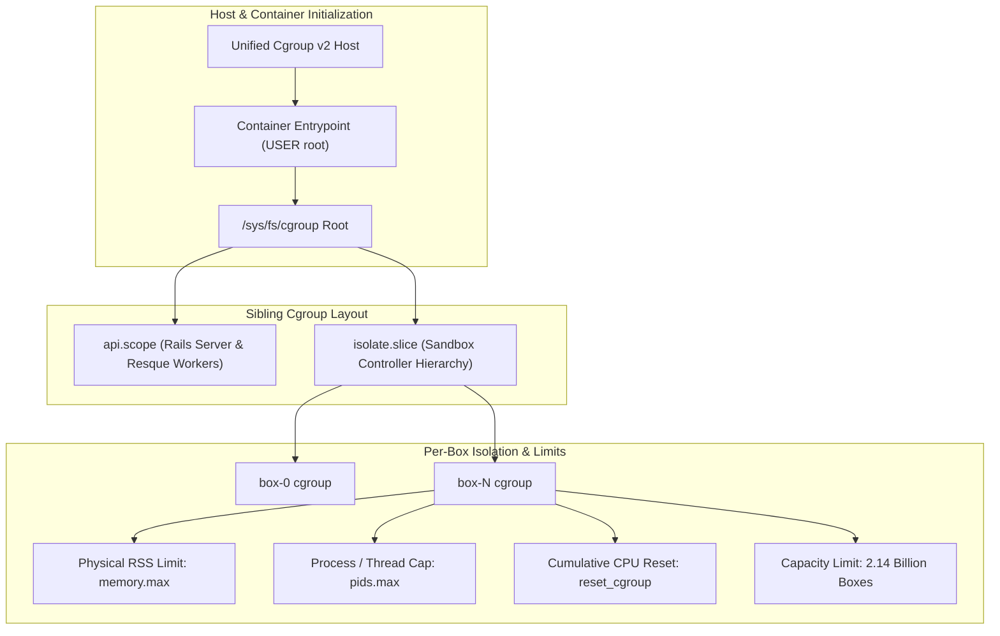
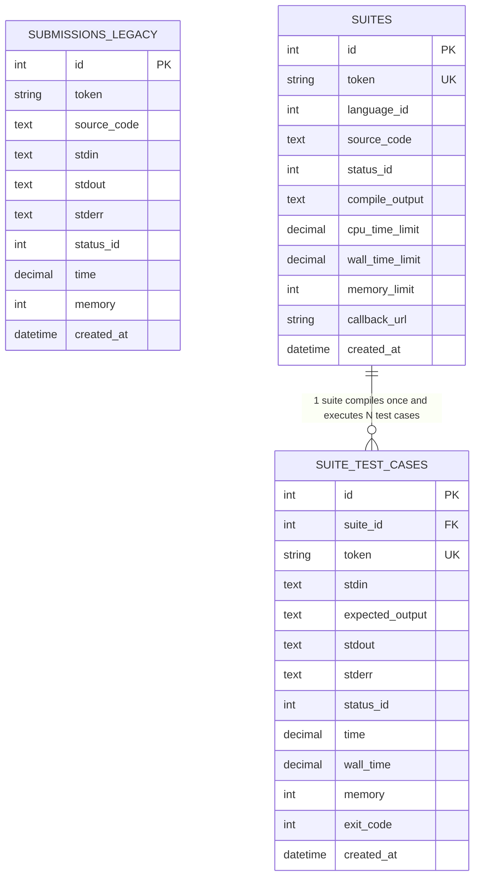

```mermaid
flowchart TD
    subgraph Original_Judge0["Original Upstream Judge0 (Legacy Batch API)"]
        O1["Client: POST /submissions/batch"] --> O2["Rails API Server"]
        O2 --> O3["PostgreSQL: N Submission Records"]
        O2 --> O4["Redis Queue: N Slots Occupied"]
        O4 --> O5["Cluster Workers Hijacked"]
        O5 --> O6["Recompile Source Code N Times"]
        O6 --> O7["Run Test Case and Destroy Sandbox"]
    end

    subgraph Modern_Judge0["Modernized Engine (Compile-Once Suite API)"]
        M1["Client: POST /suites"] --> M2["Rails API Server"]
        M2 --> M3["PostgreSQL: 1 Suite + N Test Cases"]
        M2 --> M4["Redis Queue: 1 Slot Occupied"]
        M4 --> M5["Single Resque Worker"]
        M5 --> M6["Init Sandbox Once"]
        M6 --> M7["Compile Source Code ONCE"]
        M7 --> M8{"Compilation Success?"}
        M8 -- "NO" --> M9["Fail-Fast Abort in 0.78s (Run 0 Tests)"]
        M8 -- "YES" --> M10["Run Test 1 -> reset_cgroup"]
        M10 --> M11["Run Test 2 -> reset_cgroup"]
        M11 --> M12["Run Test N -> reset_cgroup"]
        M12 --> M13["Final Suite Results & Webhooks"]
    end
```

# Judge0 Architecture: Original vs. Modernized Engine

---

## 1. Executive Execution Flow Comparison

### Visual Architecture Flowchart (ASCII)

```text
====================================================================================================
                        ORIGINAL UPSTREAM JUDGE0 (Legacy Batch API)
====================================================================================================

Client Application
       │
       ▼  POST /submissions/batch (e.g. 50 Test Cases)
[ Rails API Server ]
       │
       ├─► Creates 50 independent records in 'submissions' table
       │
       ▼  Pushes 50 individual jobs into Redis (resque:queue:submissions)
[ Redis Queue ] (Limited by MAX_QUEUE_SIZE = 200 slots)
       │
       ▼  Workers pull 50 jobs concurrently (hijacking all worker threads)
[ Resque Worker Pool ]
       │
       ├─► Job 1: Init Isolate Box ──► Compile (g++/javac ~800ms) ──► Run Test 1 (10ms) ──► Destroy Box
       ├─► Job 2: Init Isolate Box ──► Compile (g++/javac ~800ms) ──► Run Test 2 (10ms) ──► Destroy Box
       ├─► ...
       └─► Job 50: Init Box ─────────► Compile (g++/javac ~800ms) ──► Run Test 50 (10ms) ─► Destroy Box

   ⚠️ Result: 50 Compilations! ~40s wasted CPU burn. Redis queue saturated. All workers blocked.


====================================================================================================
                     MODERNIZED JUDGE0 ENGINE (Compile-Once Suite API)
====================================================================================================

Client Application
       │
       ▼  POST /suites (1 Suite containing 50 Test Cases)
[ Rails API Server ]
       │
       ├─► Creates 1 Suite record + 50 SuiteTestCase records
       │
       ▼  Pushes EXACTLY 1 Job into Redis (resque:queue:suites)
[ Redis Queue ] (Consumes only 1 slot out of 200!)
       │
       ▼  Single worker pulls SuiteJob (remaining workers stay free for other students)
[ Single Resque Worker ]
       │
       ▼
[ Init Isolate Box N ] (Once per suite)
       │
       ▼
[ Compile Source Code ] (Compiles EXACTLY ONCE: ~800ms)
       │
       ├─► IF Syntax Error (CE):
       │      └─► Abort immediately in 0.78s. Mark all 50 tests CE. Execute ZERO tests!
       │
       └─► IF Compile Success:
              │
              ▼  Loop sequentially through test cases inside the same sandbox
              ├─► Run Test 1 (10ms) ──► reset_cgroup (wipes kernel CPU/mem to 0.0s)
              ├─► Run Test 2 (10ms) ──► reset_cgroup (wipes kernel CPU/mem to 0.0s)
              ├─► ...
              └─► Run Test 50 (10ms) ─► reset_cgroup (wipes kernel CPU/mem to 0.0s)
              │
              ▼
[ Complete Suite Telemetry & Streaming Webhooks ]

   ✔ Result: 1 Compilation! ~1.2s total execution. 99% CPU saved. Zero queue pressure.
====================================================================================================
```

### Mermaid Diagram


---

## 2. Sandboxing & Cgroup Architecture

### Visual Sandbox Flow (ASCII)

```text
====================================================================================================
                       ORIGINAL SANDBOX (Legacy cgroup v1 & rlimit)
====================================================================================================

   Host Kernel (Debian 12 / Ubuntu 22.04+ / Windows WSL2: Unified Cgroup v2)
       │
       ▼
   Container starts as unprivileged USER judge0 (UID 1000)
       │
       ▼
   Attempts to write to /sys/fs/cgroup/memory/box-N (Path does not exist in cgroup v2!)
       │
       ▼
   ❌ Error: "cgroup.subtree_control not writable / cgroup v2 setup unavailable"
       │
       ▼
   Falls back to standard Linux RLIMIT Mode (setrlimit RLIMIT_AS)
       │
       ├─► Java 21 OpenJDK startup pre-allocates 1.5 GB virtual address space
       │      └─► 💥 Crash: OutOfMemoryError (even though physical memory is only 40 MB!)
       │
       ├─► Python 3.11 with NumPy pre-allocates virtual memory
       │      └─► 💥 Crash: MemoryError
       │
       └─► Sandbox Box Limit hardcoded to num_boxes = 1000 in /usr/local/etc/isolate
              └─► 💥 After 1,000 runs: "Sandbox ID out of range"


====================================================================================================
                     MODERNIZED SANDBOX (Hardened Unified Cgroup v2)
====================================================================================================

   Host Kernel (Debian 12 / Ubuntu 22.04+ / Windows WSL2: Unified Cgroup v2)
       │
       ▼
   Container starts as USER root with passwordless sudo
       │
       ▼  docker-entrypoint.sh configures Sibling Hierarchy:
   /sys/fs/cgroup/ (Container Cgroup Root)
       │
       ├── api.scope/ (Rails server & Resque workers moved here)
       │      └─► Satisfies Cgroup v2 "No Internal Processes" constraint!
       │
       └── isolate.slice/ (Sandbox parent directory)
              │
              ├─► Controllers delegated: +cpu +memory +pids
              ├─► Path registered in /run/isolate/cgroup
              │
              ├── box-0/  ──► Controlled by Isolate v2.0
              ├── box-1/  ──► Physical Resident Set Size (RSS) enforced via memory.max
              └── box-N/  ──► num_boxes patched to 2,147,483,647 (INT_MAX)

   ✔ Java 21 runs cleanly at 20MB - 74MB RSS (no virtual memory crash)
   ✔ reset_cgroup (rmdir/mkdir) wipes cpu.stat between tests, eliminating cumulative CPU leaks
   ✔ Fully compatible with Windows Docker Desktop WSL2 and modern Linux
====================================================================================================
```

### Mermaid Diagram


---

## 3. Database Schema Evolution



---

## 4. Architectural Comparison Table

| Architecture Dimension | Original Upstream Judge0 (`/submissions/batch`) | Modernized Engine (`/suites`) |
| :--- | :--- | :--- |
| **API Paradigm** | Flat array of individual submissions | Hierarchical domain model (`Suite` $\to$ `N SuiteTestCases`) |
| **Compilation Frequency** | Compiles code **$N$ times** for $N$ test cases | Compiles code **1 time** for $N$ test cases |
| **Compilation Error (CE)** | Attempts compilation $N$ times, failing each individually (~35s wasted) | Short-circuits immediately in **0.78s**, running 0 test cases |
| **Redis Queue Impact** | Consumes $N$ slots (triggers `HTTP 503: Queue is full` beyond 200) | Consumes **1 slot per suite** (handles 15,000+ tests safely) |
| **Cluster Worker Load** | Hijacks multiple worker threads simultaneously | Confines execution to **1 worker process**, freeing others |
| **Cgroup Hierarchy** | Hardcoded cgroup v1 paths (`/sys/fs/cgroup/memory`) | Sibling hierarchy: `api.scope` + `isolate.slice` |
| **Memory Enforcement** | Virtual memory (`RLIMIT_AS`) causing fake Java/Python OOMs | Real Resident Set Size (`memory.max` RSS tracking) |
| **Sandbox Concurrency Limit**| Capped at 1,000 runs (`num_boxes = 1000`) | Scaled to **2.14 Billion runs** (`num_boxes = INT_MAX`) |
| **Cgroup CPU Accumulation** | Leaks CPU across processes inside the same box | `reset_cgroup` wipes node between runs (zero leakage) |
| **Log Management** | Hardcoded `debug` level causing 22 GB disk bloat | Configurable `RAILS_LOG_LEVEL=warn` with fail-fast validation |
| **Database Performance** | Sequential table scans during cleanup jobs | Added B-tree indexes on `created_at` across all tables |
| **Supported Run-times** | Monolithic 60+ unmaintained compilers | Lean 4 OA languages: C (GCC 12), C++20, Java 21, Python 3.11 |
