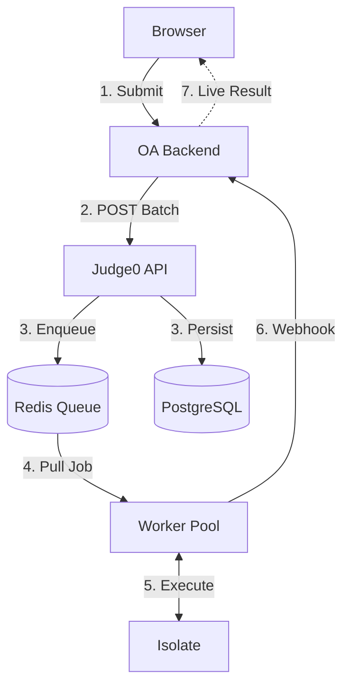
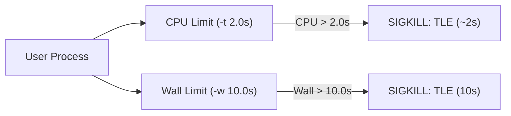
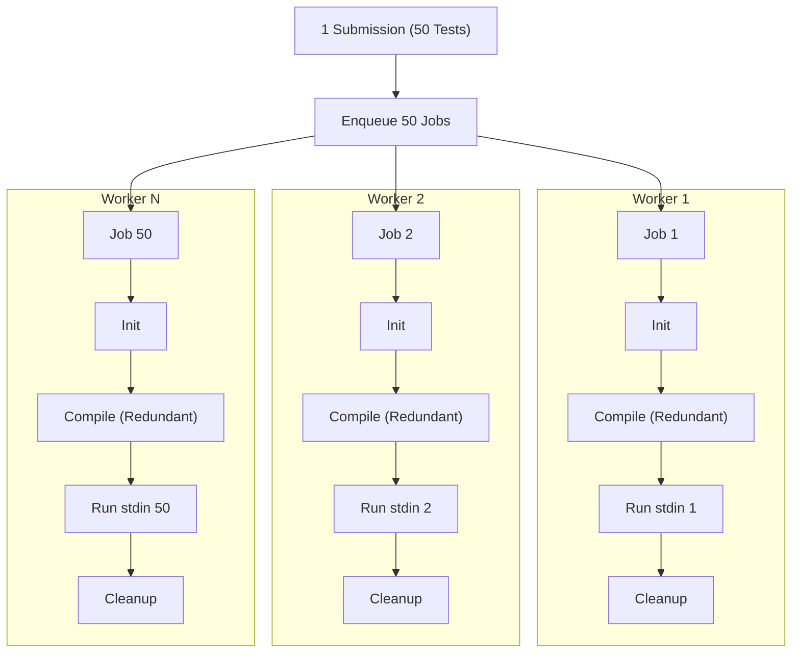
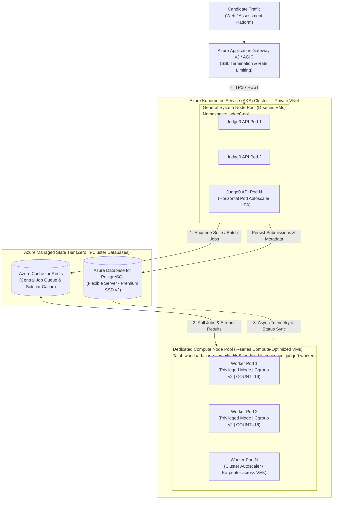
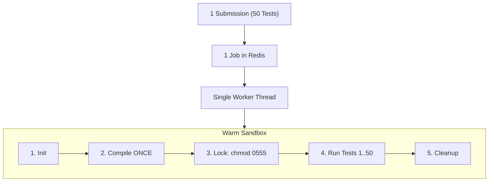

# Infrastructure Sizing & Technical Assessment: Hosting Judge0 for Online Assessments

**Document Version:** 1.0  
**Target Environment:** Microsoft Azure Cloud  
**Evaluation Scope:** Upstream Judge0 Baseline vs. Optimized In-House Suite Engine Prototype  

---

# PART 1: THE ORIGINAL JUDGE0 (Baseline Architecture & Cost)

---

## Slide 1: Title & Executive Overview

* **Topic:** Infrastructure Sizing & Architecture Assessment for the Online Assessment (OA) Module
* **Objective:** Objectively evaluate upstream Judge0, understand its kernel-level resource model, establish candidate latency baselines, and determine the Azure infrastructure required for our assessment module.
* **Scope of Discussion:**
  1. Sandboxing Mechanics (Linux Kernel, CPU Time vs. Wall Time)
  2. Upstream Execution Flow & Queue Architecture
  3. Empirical Benchmarks (Measured on 12-thread host)
  4. Real-World Assessment Failure Modes (10s Wall-Time Trap & Queue Drain Delay)
  5. Production Topology (Isolation of PostgreSQL, Redis, and Worker Compute)
  6. Baseline Azure Infrastructure Sizing & Compute Cost Matrix

### Speaker Notes / Talking Points:
> *"Today I want to present an objective technical assessment of Judge0 for our Online Assessment engine. We'll look under the hood at how it enforces isolation and tracks execution time at the Linux kernel level, review the benchmark data across different worker configurations, examine how the system behaves under bursty assessment traffic, and finalize the Azure infrastructure required based on our candidate wait-time SLA."*

---

## Slide 2: System Context & Execution Pipeline

* **The Workload Reality:**
  * Candidates do **not** connect directly to Judge0; our OA backend orchestrates submissions and ingests webhook callbacks.
  * Traffic in assessments is highly **bursty and synchronized** (e.g., 100 candidates submit in the exact same window).
  * Standard competitive programming problems contain **20 to 50 test cases**.
  * 100 candidates submitting a 50-test-case problem drops **5,000 discrete executions** onto the queue at once.

### Speaker Notes / Talking Points:
> *"In our architecture, Judge0 sits securely behind our OA backend. Our backend handles the candidate session, dispatches jobs with a callback URL, and processes asynchronous webhooks. The operational challenge is traffic concurrency: unlike a relaxed practice portal where submissions trickle in, an online assessment creates massive, synchronized bursts. 100 students submitting a 50-test-case problem simultaneously drops 5,000 execution workloads onto the system all at once."*

---

## Slide 3: Judge0 Core Mechanics — Sandbox & The Dual Clocks

* **The Sandbox (`isolate`):**
  * Runs each process in a lightweight, chrooted container with restricted disk access, network disabled, PID limits, and Linux cgroup v2 limits.
* **The Two Clocks:**
  1. **CPU Time (`-t 2.0s`):**
     * Measures actual CPU instructions executed (User space + Kernel space).
     * The clock stops when the process is waiting on I/O or sleeping.
     * Evaluates algorithmic complexity ($O(N)$ vs $O(N^2)$).
  2. **Wall Time (`-w 10.0s`):**
     * Measures absolute real-world elapsed time.
     * Ticks steadily regardless of CPU activity.
     * Watchdog against deadlocks, sleeping processes (`sleep(10)`), or unread `stdin`.

### Speaker Notes / Talking Points:
> *"Judge0 relies on Isolate and Linux cgroup v2. It tracks two distinct clocks: CPU time measures algorithmic complexity, while Wall time acts as an absolute watchdog. If code enters an infinite sleep or hangs on stdin, CPU time is zero, so without a wall-time watchdog, that thread would hang indefinitely."*

---

## Slide 4: Upstream Execution Flow & Schema Duplication

#### **1. Database Schema Duplication (`submissions` table):**
*(Showing 3 of the 50 rows created in PostgreSQL for a single submission)*

| id | source_code | language_id | stdin | expected_output | cpu_time_limit | status_id |
| :---: | :--- | :---: | :--- | :--- | :---: | :---: |
| 1001 | `#include <iostream>...` | 54 | `5 10\n` | `15\n` | 2.0 | 3 (Accepted) |
| 1002 | `#include <iostream>...` | 54 | `20 30\n` | `50\n` | 2.0 | 3 (Accepted) |
| 1003 | `#include <iostream>...` | 54 | `100 200\n` | `300\n` | 2.0 | 3 (Accepted) |
| ... | *(Repeated 47 more times)* | ... | ... | ... | ... | ... |

* **The Multiplier Effect:**
  * For 50 test cases, the complete source code, compiler flags, and configuration are duplicated **50 separate times** across the database and queue.

#### **2. Resulting Upstream Execution Flow:**

* **Architectural Observation:**
  * Because 50 independent records exist, the compiler (`g++` / `javac`) is invoked **50 separate times** for the exact same source code.
  * Every single test case pays the full compilation latency penalty before execution begins.

### Speaker Notes / Talking Points:
> *"Notice the database table above: when a student submits code with 50 test cases, upstream Judge0 creates 50 individual records in PostgreSQL, duplicating the full source code 50 times. As shown in the diagram below it, this enqueues 50 independent jobs into Redis. The workers pull these jobs concurrently and re-compile the identical code from scratch 50 separate times. We'll examine the exact empirical cost of this compiler overhead when we look at the benchmark data on Slide 5."*

---

## Slide 5: Original Judge0 Benchmark Data

#### **1. Benchmark Test Rig Specifications:**
* **Host Processor:** 12 Logical CPU Threads (Intel/AMD x86_64)
* **Host Memory:** 16 GB Physical RAM
* **OS & Kernel:** Windows 11 host running Docker Desktop on WSL2 Linux Kernel
* **Orchestration:** KinD (Kubernetes-in-Docker) local cluster (`judge0-cluster`)
* **Languages Tested:** C (GCC 12.2), C++20 (G++ 12.2), Java 21 (OpenJDK 21 LTS), Python 3.11 with NumPy
* **Workload Evaluated:** **500 independent compilations & sandboxed executions** in 10 batches of 50 (Upstream API: `POST /submissions/batch`)

#### **2. Upstream Measured Benchmark Scaling Table:**

| Helpers (`COUNT`) | Total Wall Time | Execution Throughput | Median Latency ($p_{50}$) | 99th Percentile ($p_{99}$) |
| :---: | :---: | :---: | :---: | :---: |
| **2 Helpers** | 220.0 s | **2.27 TCs/sec** | 11.7 s | 22.8 s |
| **4 Helpers** | 121.4 s | **4.12 TCs/sec** | 6.2 s | 11.8 s |
| **8 Helpers** | 84.8 s | **5.89 TCs/sec** | **4.3 s** (Lowest) | 8.1 s |
| **12 Helpers** | 86.9 s | **5.75 TCs/sec** | 5.0 s | 8.3 s |
| **16 Helpers** | 82.4 s | **6.07 TCs/sec** | 4.4 s | 7.5 s |
| **24 Helpers** | 77.1 s | **6.49 TCs/sec** | 5.1 s | 7.1 s |

#### **3. Architectural Analysis:**
* **Throughput Plateau:** Scales from 2.2 up to **~6.0 test cases/sec**, hitting a ceiling regardless of adding more workers.
* **The Root Bottleneck:** Workers spend **~85% to 90% of their CPU time running `g++` and `javac`** rather than evaluating test cases.
* **Baseline Heuristic:** Under upstream Judge0, **1 vCPU core delivers $\approx$ 0.5 to 0.65 test cases/sec**.

### Speaker Notes / Talking Points:
> *"Here is the empirical data from 500 test cases on a 12-thread host. Notice how throughput hits a wall at ~6 test cases per second. Even when we throw 16 or 24 workers at it, throughput doesn't scale because the CPU is saturated compiling the same C++ and Java code over and over again. The fundamental rule of thumb for upstream Judge0 is that 1 vCPU gives you about 0.65 test cases per second."*

---

## Slide 6: Real-World Assessment Failure Modes: The 10s Wall-Time Trap & Queue Delay

#### **Problem 1: Idle Hangs & The Wall-Time Contention Dilemma**
* **The Scenario:** Candidate #10 submits code containing an unread `cin/scanf` hang or an infinite loop with `sleep(1)` evaluated against 40 large test cases.
* **Worker Process Blocking:**
  * Because CPU time is `0.00s`, each test case runs until the full **10.0-second Wall Time limit**.
  * While waiting, the parent Judge0 worker process is **blocked synchronously**, unable to poll Redis or process other candidates.
  * Total worker execution time: $40 \text{ test cases} \times 10.0\text{s} = \mathbf{400\text{ seconds (6.6 minutes)}}$.

* **Upstream Worker Pool Saturation (Head-of-Line Blocking):**
  * In upstream Judge0, those 40 hanging test cases are split into **40 independent jobs in Redis**.
  * Worker threads pull these 10-second jobs concurrently, quickly exhausting available worker slots.
  * Candidates #11 through #100 experience head-of-line blocking, waiting in the queue while workers wait out the 10-second watchdog cycles.

* **The Sizing Dilemma: Why CANNOT Wall Time be reduced (e.g. to 2.5s or 3.0s)?**
  * Under heavy concurrent load on an Azure VM, the Linux CPU scheduler pauses and resumes worker processes constantly.
  * A completely valid $O(N)$ student solution that only needs 1.8s of real CPU will take **5 to 7 seconds of real-world wall-clock time** to accumulate those CPU cycles under CPU contention.
  * If we lower Wall Time below 10.0s, **legitimate student solutions get killed with false TLEs** simply because the server was busy.
  * **The 10.0s limit is a necessary safety cushion** to prevent false student failures during peak server load.

#### **Problem 2: Normal Queue Drainage Lag (Even for 100% Valid Code)**
* **Workload:** 100 candidates submit at $t = 0$ ($100 \times 50 = \mathbf{5,000\text{ jobs}}$ enqueued into Redis).
* **Measured Throughput on 12-Core Host:** **~6.0 test cases/sec** (Total drain time: $5,000 / 6.0 \approx \mathbf{13.8\text{ minutes}}$).

| Candidate Position in Queue | Jobs Ahead in Redis | Wait Time for Final Result (12-Core VM) | Wait Time on Budget 4-Core VM (~4 TCs/s) |
| :---: | :---: | :---: | :---: |
| **Candidate #1** | 0 jobs | **~8.3 seconds** | **~12.5 seconds** |
| **Candidate #10** | 450 jobs | **~75 seconds** (1.2 min) | **~112 seconds** (1.9 min) |
| **Candidate #25** | 1,200 jobs | **~200 seconds** (3.3 min) | **~300 seconds** (5.0 min) |
| **Candidate #50** | 2,450 jobs | **~408 seconds** (6.8 min) | **~612 seconds** (10.2 min) |
| **Candidate #75** | 3,700 jobs | **~616 seconds** (10.2 min) | **~925 seconds** (15.4 min) |
| **Candidate #100** | 4,950 jobs | **~825 seconds** (13.7 min) | **~1,250 seconds** (20.8 min) |

* **Operational Impact:** Even without deadlocks, candidates waiting beyond 3–5 minutes assume the system dropped their request and hit "Submit" again, compounding queue backlog.

### Speaker Notes / Talking Points:
> *"Here is the operational reality during an exam. First, look at what happens when a student submits code that hangs on an unread input or sleep: it burns zero CPU, so it runs until the 10-second Wall Time limit. Across 40 test cases, that's 400 seconds of execution time. Why can't we lower Wall Time to 2 or 3 seconds? Because under server load, context-switching means legitimate code takes 5 to 7 seconds of wall time to accumulate its CPU cycles. If we drop wall time, valid student code falsely fails. So we must keep Wall Time at 10 seconds. In upstream Judge0, those 40 tests split into 40 Redis jobs, saturating all workers and stalling the queue. And second, look at the table: even if every student writes 100% valid code with zero deadlocks, 5,000 jobs running at 6 test cases per second means Candidate 100 still waits 14 to 20 minutes for their result."*

---

## Slide 7: Enterprise Production Topology — AKS Cluster, Node Pools & Managed PaaS

### Key Architectural Pillars:

1. **Azure Kubernetes Service (AKS) Core Architecture:**
   * **Stateless API Tier:** The Judge0 API server is a stateless Ruby on Rails application. It runs in the general system node pool behind **Azure Application Gateway v2** (with Ingress Controller - AGIC) and auto-scales dynamically via Kubernetes **Horizontal Pod Autoscaler (HPA)** based on incoming HTTP request volume.
   * **Dedicated Privileged Compute Tier:** The Isolate sandbox requires `securityContext: privileged: true` to configure Linux cgroup v2 hierarchies (`api.scope` and `isolate.slice`). Untrusted student executions are **never mixed** with general microservices.
   * **Node Pool Taints & Tolerations:** Worker pods run strictly on a dedicated AKS node pool (`Standard_F16s_v2` compute-optimized instances) enforced by Kubernetes taints (`workload=code-compiler:NoSchedule`) and matching pod tolerations.

2. **Dual-Dimension Worker Scaling:**
   * **Horizontal Scaling (Across VM Nodes):** During massive assessment windows (e.g., thousands of simultaneous candidates), the AKS Cluster Autoscaler / Karpenter dynamically provisions additional `Standard_F16s_v2` nodes.
   * **Vertical Scaling (Inside each Pod):** Each worker pod executes multiple parallel Resque worker processes controlled by `COUNT=16`, matching the physical execution pipelines of the underlying 16-vCPU instance.
   * **Decoupled Job Coordination:** All worker processes across all VMs pull jobs off the **same central Azure Cache for Redis** independently without lock contention or cross-worker interference.

3. **Why All-In-One Docker Compose Fails in Enterprise Production:**
   * **Worker OOM Isolation:** Student code (e.g., recursive memory leaks or runaway JVM allocations) can trigger the Linux kernel Out-Of-Memory (OOM) killer. If PostgreSQL or Redis share the worker host, the database process is killed and the entire queue is wiped out.
   * **Disk IOPS Contention:** High-frequency compilation (`gcc`, `g++`, `javac`) and sandbox disk creation (`/var/local/lib/isolate/`) burn massive IOPS. Sharing the same OS disk with PostgreSQL Write-Ahead Logs (WAL) severely throttles both compilation and database commits.
   * **Zero In-Cluster Databases (Managed PaaS):** Moving state to **Azure Database for PostgreSQL Flexible Server** and **Azure Cache for Redis** makes the compute nodes 100% disposable and stateless. Worker node pools can be dynamically scaled up 15 minutes before an exam and deallocated immediately afterward to save costs.

4. **Industry Battle-Testing (The Newton School Blueprint):**
   * This exact 3-tier architecture—Kubernetes cluster with a dedicated privileged compiler node pool + Karpenter autoscaling + managed external PostgreSQL & Redis—is the **identical battle-tested topology used by Newton School** (on AWS EKS) to evaluate millions of student submissions reliably.

---

### Speaker Notes / Talking Points:
> *"Let’s look at the production architecture on Azure. Upstream Judge0 includes a default docker-compose file with Postgres and Redis packaged onto the same single machine. In an enterprise exam environment, that is an operational disaster waiting to happen: sandboxed student code can trigger the Linux kernel OOM killer, which would kill Redis and wipe out the active queue. Furthermore, compiling code burns heavy disk IOPS, which starves the database.*
>
> *To make this enterprise-grade on Azure, we separate the architecture into three clean tiers:*
>
> * **First, the Managed State Tier:** Zero databases run inside the cluster. We use Azure Database for PostgreSQL Flexible Server and Azure Cache for Redis. This means our data and queues are fully redundant, managed, and never at risk of a worker crash.
> * **Second, the API Tier on AKS:** The Judge0 API runs in a standard AKS system node pool behind the Azure Application Gateway. It scales horizontally via HPA based on candidate traffic without touching the workers.
> * **Third, the Dedicated Worker Compute Pool on AKS:** Because the Isolate sandbox requires privileged mode to manage Linux cgroups and namespaces, we enforce complete physical isolation. Workers run on a dedicated AKS node pool using compute-optimized F-series VMs, protected by Kubernetes taints (`workload=code-compiler:NoSchedule`). Student code never touches our API or database nodes.
> * **Scaling:** We achieve two-dimensional scaling: workers scale horizontally across multiple VMs using the cluster autoscaler, and vertically inside each VM using 16 parallel worker threads. This is the exact architectural blueprint used by major platforms like Newton School to evaluate millions of coding submissions with zero downtime."*

---

## Slide 8: Enterprise Azure Architecture & Sizing Matrix (Upstream Judge0)

*Workload Profile: 100 simultaneous candidates $\times$ 50 test cases = **5,000 independent compilations & runs***  
*Throughput Rule of Thumb for Upstream: **1 vCPU core $\approx$ 0.65 test cases/sec***

---

### 1. Fixed Enterprise Platform Foundation (Always-On Baseline)
These core managed Azure services provide database durability, queue resilience, SSL ingress, and cluster orchestration. They remain active 24/7 regardless of exam traffic:

| Azure Service | SKU / Configuration | Role in Architecture | Est. Monthly Cost |
| :--- | :--- | :--- | :---: |
| **Azure Application Gateway v2** | Standard v2 (Autoscaling 1–5 units) | SSL/TLS termination, rate limiting, and AKS Ingress (AGIC) | ~$175 / mo |
| **AKS System Node Pool** | 2 $\times$ `Standard_D2s_v5` (4 vCPUs, 16 GB) | Hosts stateless Rails API pods, CoreDNS, and ingress controllers | ~$140 / mo |
| **Azure DB for PostgreSQL** | Flexible Server `Standard_D2ds_v5` (Premium SSD v2) | Persistent ACID submission records, languages seed, automated backups | ~$135 / mo |
| **Azure Cache for Redis** | Standard C2 (2.5 GB, High Availability Master/Replica)| Central Resque job queue and telemetry cache | ~$80 / mo |
| **Azure Container Registry (ACR)**| Standard Tier | Secure private storage of compiler & worker container images | ~$20 / mo |
| **Azure Monitor & Log Analytics** | Container Insights (5 GB data ingestion) | Centralized stdout/stderr logging, pod metrics, and alerting | ~$30 / mo |
| **KEDA Event-driven Scaler** | **Native Managed AKS Add-on** | Scales worker pods based on real-time Redis queue depth | **$0.00 (FREE)** |
| **AKS Cluster Autoscaler** | **Native Built-in AKS Engine** | Automatically provisions/deprovisions VM nodes on demand | **$0.00 (FREE)** |
| **Baseline Platform Subtotal** | **Core Foundation (Always-On)** | **Enterprise Reliability & High-Availability Baseline** | **~$580 / month** |

---

### 2. Elastic Worker Compute Pool Sizing (Upstream Judge0 Engine)
Workers run on a dedicated AKS node pool with compute-optimized F-series VMs (`Standard_F16s_v2` @ ~$0.67/hr per VM). 
* **Elastic Cost Model:** Thanks to **KEDA + AKS Cluster Autoscaler (both $0)**, worker VMs only run during active assessment windows and terminate automatically when the queue empties.

| Target Clear SLA | Max Candidate Wait | Required vCPUs | Azure Dedicated Node Pool Setup | Active Hourly Cost | 24/7 Cost (Reference) |
| :---: | :---: | :---: | :--- | :---: | :---: |
| **1 Minute** | ~60 sec | **~128 vCPUs** | **8 $\times$ `Standard_F16s_v2`** (Tainted Compute Pool) | **~$5.40 / hr** | ~$3,920 / mo |
| **2 Minutes** | ~2 min | **~64 vCPUs** | **4 $\times$ `Standard_F16s_v2`** (Tainted Compute Pool) | **~$2.70 / hr** | ~$1,960 / mo |
| **3 Minutes** | ~3 min | **~44 vCPUs** | **3 $\times$ `Standard_F16s_v2`** (Tainted Compute Pool) | **~$2.00 / hr** | ~$1,470 / mo |
| **4 Minutes** | ~4 min | **~32 vCPUs** | **2 $\times$ `Standard_F16s_v2`** (Tainted Compute Pool) | **~$1.35 / hr** | ~$980 / mo |
| **5 Minutes** | ~5 min | **~24 vCPUs** | **3 $\times$ `Standard_F8s_v2`** (Tainted Compute Pool) | **~$1.02 / hr** | ~$735 / mo |
| **Budget Tier** | **15–20+ min** | **4–8 vCPUs** | **1 $\times$ `Standard_F4s_v2` / `F8s_v2`** | **~$0.34 / hr** | ~$245 / mo |

---

### 3. Key Financial & Operational Insights for Stakeholders:
1. **Zero-Cost Elastic Autoscaling:** KEDA and the AKS Cluster Autoscaler are native, free features. We pay zero software licensing fees—we strictly pay for VM compute seconds during live tests.
2. **Predictable Base Budget:** The platform foundation is **fixed at ~$580/month**. 
3. **Pay-Per-Assessment Efficiency:** For a 2-hour assessment requiring a strict **2-Minute SLA** (4 $\times$ F16s_v2), the total compute cost is just **$5.40 for the entire exam** ($2.70/hr $\times$ 2 hrs).

---

### Speaker Notes / Talking Points:
> *"Let’s look at the complete financial and infrastructure picture on Azure. To give full transparency to leadership, we divide our costs into two distinct buckets:*
>
> * **First, the Fixed Platform Foundation:** This costs approximately **$580 per month**. It covers our managed Azure Postgres database, Azure Cache for Redis, the AKS system node pool running our API, Azure Application Gateway for SSL ingress, and Azure Container Registry. Notice that both **KEDA** (our queue-based scaler) and the **AKS Cluster Autoscaler** are **completely free** built-in features on Azure.
> * **Second, the Elastic Worker Compute Pool:** This is where we choose our candidate wait-time SLA. Because upstream Judge0 recompiles code on every single test case, 1 vCPU clears about 0.65 test cases per second. 
>   * If our business SLA demands that 100 students get their verdicts within **2 minutes**, we need **64 vCPUs** (4 Standard_F16s VMs).
>   * If a **4-minute wait** is acceptable, we need **32 vCPUs** (2 Standard_F16s VMs).
> * **The Key Takeaway for the CFO:** Because our dedicated worker node pool scales elastically to zero via KEDA, we do not need to run these compute VMs 24/7. For a 2-hour coding test with a 2-minute SLA, the actual compute cost is only **$5.40 for the entire exam**. The primary architectural decision for leadership is simply: what is our acceptable candidate wait-time SLA?"*

---

# PART 2: THE IN-HOUSE PROTOTYPE (Exploratory Optimization)

---

## Slide 9: The Prototype Concept: Compile-Once Suite Engine (`/suites`)

* **Framing:**
  > *"To see if we could protect against queue saturation on a leaner infrastructure budget, I implemented and tested an experimental `/suites` prototype."*

### Speaker Notes / Talking Points:
> *"Seeing this compile bottleneck and queue saturation, I built an experimental `/suites` prototype as a testbed. The idea was simple: keep Isolate's robust sandbox, compile the code once, lock the sandbox to read-only so student code cannot alter the binary, and run all 50 test cases sequentially inside that warm container. This reduces the Redis footprint from 50 jobs down to 1."*

---

## Slide 10: Normalized Database Schema & Security Fixes

#### **The Normalized Schema (`suites` & `suite_test_cases`):**
Instead of repeating source code 50 times in one flat table, the prototype normalizes data:

**Table: `suites` (1 Row per Submission)**
| id | token | source_code | language_id | status_id |
| :---: | :---: | :--- | :---: | :---: |
| 501 | `a1b2-c3d4` | `#include <iostream>...` | 54 | 3 (Accepted) |

**Table: `suite_test_cases` (50 Rows linked by `suite_id`)**
| id | suite_id | stdin | expected_output | cpu_time | memory | status_id |
| :---: | :---: | :--- | :--- | :---: | :---: | :---: |
| 1 | 501 | `5 10\n` | `15\n` | 0.012s | 3,120 KB | 3 (Accepted) |
| 2 | 501 | `20 30\n` | `50\n` | 0.015s | 3,120 KB | 3 (Accepted) |

* **Engineering Safeguards Added:**
  1. **Sandbox Lock (`chmod 0555`):** Executable cannot be modified by user code between test cases.
  2. **Cgroup v2 Reset (`reset_cgroup`):** Re-creates the cgroup slice between test cases so kernel CPU time is reset to `0.00s` for every test case, eliminating false TLEs.

### Speaker Notes / Talking Points:
> *"In the prototype, the database is normalized: source code is stored once in the `suites` table, while individual test results link to it via `suite_test_cases`. I also solved a Linux cgroup v2 trap where CPU counters accumulate across runs: `reset_cgroup` re-initializes the cgroup slice between test runs so every test case gets microsecond-accurate time measurement with zero CPU bleed from previous tests."*

---

## Slide 11: How the Prototype Handles the Dilemma

#### **1. Blast Radius Confined to 1 Worker (IMPLEMENTED):**
* In upstream Judge0, 40 TLE test cases split into 40 jobs and seize all workers on the VM.
* In the `/suites` prototype, all 50 test cases run inside **1 single worker thread**.
* If a student's code hits 40 TLEs, only that **one worker** runs for 80 seconds.
* The remaining 7 or 11 workers on the VM continue processing submissions for other students with **zero queue interruption**.

#### **2. Early-Termination Architecture (Future Safeguards):**
* **Current Operational State:** Because the prototype isolates execution to **1 worker**, runaway submissions do not saturate the cluster. Running all test cases to completion remains safe.
* **Available Safeguards (If early cutoff is ever required):**
  * **Subtask Grouping (IOI Standard):** If a test case fails in Subtask 2, immediately skip remaining tests in Subtask 2 (points already lost), but proceed directly to evaluate Subtask 3. Preserves mathematically fair partial marks while eliminating redundant timeout cycles.
  * **Shared Suite CPU Budget:** Grant each submission an aggregate CPU budget (e.g., `MAX_SUITE_CPU = 15.0s`). Once exhausted, execution cleanly halts, guaranteeing no submission exceeds 15 seconds of worker compute.

### Speaker Notes / Talking Points:
> *"Here is how the prototype fundamentally alters the timeout problem: because an entire suite is 1 job, a student with broken code only ties up 1 single worker thread. The rest of our workers stay 100% available for other candidates. If we ever want early termination in the future, we have subtasks or suite time budgets ready, but right now confining the execution to 1 worker solves cluster saturation without needing complex early cutoff rules."*

---

## Slide 12: Head-to-Head Benchmark Specs & Measured Data

#### **1. Benchmark Test Rig Specifications:**
* **Host Processor:** 12 Logical CPU Threads (Intel/AMD x86_64)
* **Host Memory:** 16 GB Physical RAM
* **OS & Kernel:** Windows 11 host running Docker Desktop on WSL2 Linux Kernel
* **Orchestration:** KinD (Kubernetes-in-Docker) local cluster (`judge0-cluster`)
* **Total Volume in Study:** **93,000 sandboxed test executions** across 12 full runs with a 100% Accepted pass rate.
* **Languages Tested:** C (GCC 12.2), C++20 (G++ 12.2), Java 21 (OpenJDK 21 LTS), Python 3.11 with NumPy.

#### **2. The Test Loads Evaluated:**
* **Upstream Batch API (`/submissions/batch`):** 500 independent compilations & runs in 10 batches of 50.
* **Suite Engine Prototype (`/suites`):** **15,000 sandboxed executions per helper tier** (150 suites $\times$ 100 test cases each). Exactly 150 compilations, eliminating 14,850 redundant compiler runs.

#### **3. Measured Performance Comparison:**

| Helpers (`COUNT`) | Upstream Throughput | Prototype Throughput | Prototype Median Latency ($p_{50}$) | Prototype 99th Percentile ($p_{99}$) |
| :---: | :---: | :---: | :---: | :---: |
| **2 Helpers** | 2.27 TCs/sec | **17.20 TCs/sec** | 56.8 s | 65.1 s |
| **4 Helpers** | 4.12 TCs/sec | **33.94 TCs/sec** | 29.1 s | 41.1 s |
| **8 Helpers** | 5.89 TCs/sec | **55.53 TCs/sec** | **17.2 s** (Lowest) | 29.0 s |
| **12 Helpers** | 5.75 TCs/sec | **53.12 TCs/sec** | 20.1 s | 34.3 s |
| **16 Helpers** | 6.07 TCs/sec | **64.40 TCs/sec** | 22.2 s | 33.5 s |
| **24 Helpers** | 6.49 TCs/sec | **61.20 TCs/sec** | 37.3 s | 51.4 s |

### Speaker Notes / Talking Points:
> *"Here is the direct comparison on the same 12-thread host. Under upstream, throughput peaked at ~6 test cases per second. Under the compile-once prototype, throughput scales to 55.5 test cases per second on 8 helpers, and 64.4 on 16 helpers—a 10x throughput multiplier. And notice latency: median latency drops to 17 seconds for a full 100-test-case suite."*

---

## Slide 13: Prototype Azure Infrastructure Sizing Matrix
*(Direct row-for-row comparison with Slide 8)*

#### **Compute Required for 100 Candidates (Prototype `/suites` API)**
*Workload: 100 submissions $\times$ 50 test cases = **100 compilations + 5,000 sandboxed runs***  
*Throughput Rule of Thumb for Suite Engine: **1 vCPU core $\approx$ 6.5 to 7.0 test cases/sec***

| Target Clear SLA | Max Candidate Wait | Required vCPUs | Azure VM Setup (F-series) | Comparison vs. Upstream (Slide 8) |
| :---: | :---: | :---: | :--- | :--- |
| **1 Minute (60s)** | **~30 sec** | **~14 to 16 vCPUs** | 1 $\times$ `Standard_F16s_v2` (or 2 $\times$ `F8s_v2`) | **Requires 16 vCPUs** *(vs. 128 vCPUs upstream)* |
| **1.5 Minutes (90s)** | **~35 sec** | **~8 vCPUs** | 1 $\times$ `Standard_F8s_v2` | **Requires 8 vCPUs** *(vs. ~80 vCPUs upstream)* |
| **2 Minutes (120s)** | **~45 sec** | **~6 vCPUs** | 1 $\times$ `Standard_F8s_v2` (Light load) | **Requires 6 vCPUs** *(vs. 64 vCPUs upstream)* |
| **3 Minutes (180s)** | **~60 sec** | **~4 vCPUs** | 1 $\times$ `Standard_F4s_v2` | **Requires 4 vCPUs** *(vs. 44 vCPUs upstream)* |
| **5 Minutes (300s)** | **~90 sec** | **~2 to 4 vCPUs** | 1 $\times$ `Standard_F4s_v2` (Idle headroom) | **Requires 2–4 vCPUs** *(vs. 24 vCPUs upstream)* |
| **Budget Tier (4 vCPUs)**| **~60 sec** | **4 vCPUs** | 1 $\times$ `Standard_F4s_v2` | **Clears in 60s** *(vs. 20+ minutes upstream)* |

#### **The Direct Takeaway:**
* On **upstream Judge0** (Slide 8), meeting a 2-minute SLA requires **~64 vCPUs** (4 $\times$ `Standard_F16s_v2`).
* On the **`/suites` prototype** (Slide 13), that exact same SLA is satisfied by **8 vCPUs** (1 $\times$ `Standard_F8s_v2`), because 4,900 redundant compiler invocations were eliminated.

### Speaker Notes / Talking Points:
> *"To summarize the trade-off: if our budget allows for 32 to 64 vCPUs on Azure, upstream Judge0 is completely ready to deploy and meets our SLAs. However, if our company infrastructure budget restricts us to 8 to 16 vCPUs, this in-house prototype achieves the exact same sub-90-second SLA on a single Standard_F8s VM. We have both paths verified and ready based on our cloud allocation."*

