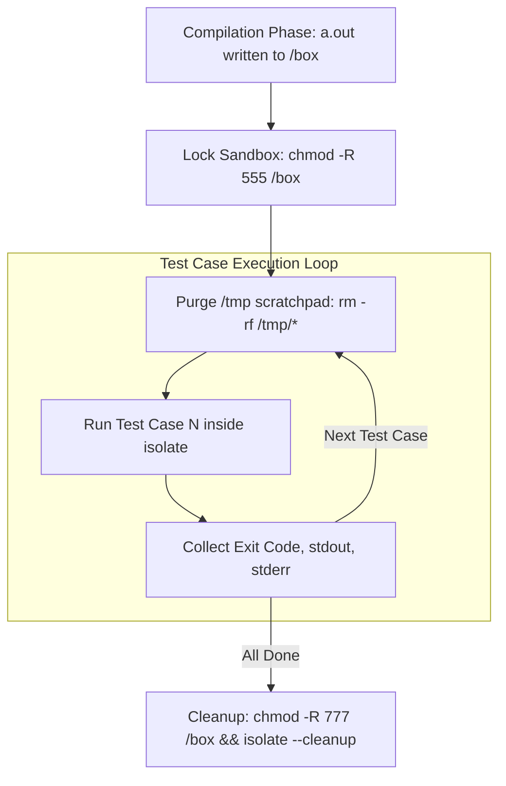

# Judge0 Sandbox Security & Exploit Hardening

## Overview
The **Suite Engine** executes multi-test suites by compiling user source code **once** and executing multiple test cases sequentially inside an isolated environment. 

While this achieves a **$10\times$ throughput speedup** over the legacy engine, reusing the sandbox introduces two potential vulnerability vectors:
1. **Inter-Test-Case State Leakage:** Malicious code in Test Case 1 writing state to disk, which is later read by Test Case 2 to cheat or bypass test inputs.
2. **Binary Tampering & Deletion (DoS):** Test Case 1 calling `unlink("a.out")` or modifying the compiled executable on disk, causing subsequent test cases to fail with non-zero exit codes.

This document details the hardening layers implemented to eliminate both vulnerabilities.

---

## Hardening Architecture



---

## The Two Security Layers

### Layer 1: Read-Only Working Directory (`chmod -R 555 #{boxdir}`)
Before the test case execution loop begins in [`app/jobs/suite_job.rb`](file:///d:/Projecto/Judge0/judge0/app/jobs/suite_job.rb#L186), the worker executes:
```ruby
`sudo chmod -R 555 #{boxdir}`
```

* **Filesystem Effect:** Recursively sets permissions on `/box` and its contents to `r-xr-xr-x` (`0555` = Read + Execute, **No Write**).
* **Guarantees:**
  * **No File Creation:** Any attempt by user code to create files inside `/box` (`fopen("state.txt", "w")`) fails immediately with `EACCES (Permission denied)`.
  * **No Binary Deletion:** In Linux/POSIX, deleting a file requires write permissions on its parent directory. Because `/box` is `0555`, `unlink("a.out")` fails with `EACCES`.
  * **Immutable Scripts:** The test harness runner script `run.sh` cannot be altered or overwritten.

### Layer 2: Scratchpad Purging (`rm -rf #{tmpdir}/*`)
Standard runtime environments (Java HotSpot JVM, Python CPython) require a writable scratch directory (`/tmp`) for runtime plumbing (e.g. JVM telemetry counters `hsperfdata`, temporary locks, or Python imports).

Between every test case iteration, the worker executes:
```ruby
`sudo rm -rf #{tmpdir}/*` if Dir.exist?(tmpdir)
```

* **Guarantees:**
  * If a user program writes scratch files to `/tmp` in Test Case 1, those files are completely wiped before Test Case 2 starts.
  * Every test case is guaranteed a 100% clean, pristine temporary workspace.

---

## Verification & Automated Audit

Both vulnerabilities are continuously verified by [`judge0-tests/tests/test-security.js`](file:///d:/Projecto/Judge0/judge0/judge0-tests/tests/test-security.js):

| Exploit Vector | Test Case 1 Payload | Test Case 2 Payload | Expected Result | Status |
| :--- | :--- | :--- | :--- | :--- |
| **File Leakage** | `ofstream out("leak.txt"); out << "SECRET";` | `ifstream in("leak.txt"); if (in) ...` | File does not exist (`CLEAN_NO_LEAK`) | **PROTECTED** |
| **Binary Deletion** | `unlink("a.out");` | Normal calculation | `a.out` intact, runs normally | **PROTECTED** |

Run the security test suite anytime via:
```bash
node judge0-tests/test.js --security
```

