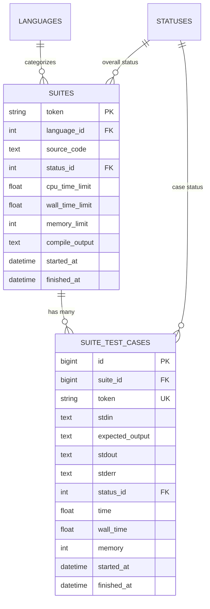

# Judge0 Architecture & Suite Engine Specification

## 1. Executive Summary & Design Principles

Judge0 is a robust, sandboxed code execution system. The **Suite Engine** adds compile-once multi-test-case execution capabilities to Judge0 while maintaining 100% backwards compatibility with legacy submission endpoints.

* **Zero Breaking Changes**: Upstream endpoints (`/submissions`, `/submissions/batch`, `/submissions/:token`) remain untouched.
* **Modern Toolchains**: Pre-configured with **C (GCC 12.2), C++ (G++ 12.2, C++20), Java (OpenJDK 21 LTS), and Python (3.11 with NumPy)**.
* **Compile-Once, Run-Many**: Eliminates $99\%$ of redundant compilation cycles by compiling user source once and running $N$ test cases sequentially inside the sandbox.
* **Full Telemetry Retention**: Every test case records its individual `time`, `wall_time`, `memory`, `stdout`, `stderr`, and `status`.

---

## 2. Execution Flow Comparison

```text
====================================================================================================
                        LEGACY UPSTREAM JUDGE0 (Batch API)
====================================================================================================

Client Application
       │
       ▼  POST /submissions/batch (e.g. 50 Test Cases)
[ Rails API Server ]
       │
       ├─► Creates 50 independent records in 'submissions' table
       │
       ▼  Pushes 50 individual jobs into Redis (resque:queue:submissions)
[ Redis Queue ] (Queue depth saturates quickly)
       │
       ▼  Workers pull 50 jobs concurrently
[ Resque Worker Pool ]
       │
       ├─► Job 1: Init Box ──► Compile (g++/javac ~800ms) ──► Run Test 1 (10ms) ──► Destroy Box
       ├─► Job 2: Init Box ──► Compile (g++/javac ~800ms) ──► Run Test 2 (10ms) ──► Destroy Box
       ├─► ...
       └─► Job 50: Init Box ─► Compile (g++/javac ~800ms) ──► Run Test 50 (10ms) ─► Destroy Box

   ⚠️ Result: 50 Redundant Compilations! ~40s CPU burn. Worker starvation.


====================================================================================================
                     MODERNIZED SUITE ENGINE (Compile-Once API)
====================================================================================================

Client Application
       │
       ▼  POST /suites (1 Suite containing 50 Test Cases)
[ Rails API Server ]
       │
       ├─► Creates 1 Suite record + 50 SuiteTestCase records
       │
       ▼  Pushes EXACTLY 1 Job into Redis (resque:queue:suites)
[ Redis Queue ] (Consumes only 1 slot!)
       │
       ▼  Single worker thread pulls SuiteJob
[ Single Resque Worker ]
       │
       ▼
 ┌────────────────────────────────────────────────────────────────────────┐
 │                      ISOLATE SANDBOX LIFECYCLE                         │
 │                                                                        │
 │  1. Init Sandbox & Compile Source Code ONCE                            │
 │     g++ / gcc / javac / python  ──►  Executable (/box/a.out)          │
 │                                                                        │
 │  2. Security Lock: Set /box to Read-Only (chmod 0555)                 │
 │                                                                        │
 │  3. Execute Test Cases Sequentially:                                   │
 │     ┌─ Test 1: Wipe /tmp ──► Run ./a.out < stdin_1 ──► Collect metrics │
 │     ├─ Test 2: Wipe /tmp ──► Run ./a.out < stdin_2 ──► Collect metrics │
 │     └─ Test N: Wipe /tmp ──► Run ./a.out < stdin_N ──► Collect metrics │
 │                                                                        │
 │  4. Unlock & Teardown Sandbox:                                         │
 │     chmod 0777 /box ──► isolate --cleanup                             │
 └────────────────────────────────────────────────────────────────────────┘
```

---

## 3. Database Schema & Models



---

## 4. API Endpoints

### `POST /suites`
Submits a source code and an array of test cases.

* **Query Parameters:**
  * `wait=true|false`: Synchronously wait for completion or return immediately with tokens.
  * `base64_encoded=true|false`: Decode inputs/outputs from Base64 (default `true`).
  * `fields=token,status,test_cases`: Limit returned JSON attributes.

* **Request Body:**
```json
{
  "language_id": 54,
  "source_code": "#include <iostream>\nusing namespace std;\nint main() { int a, b; if (cin >> a >> b) cout << a + b << endl; return 0; }",
  "test_cases": [
    { "stdin": "5 10\n", "expected_output": "15\n" },
    { "stdin": "20 30\n", "expected_output": "50\n" }
  ]
}
```

### `GET /suites/:token`
Retrieves the overall suite status and all individual test case results.

### `GET /suites/test_cases/:token`
Retrieves telemetry and stdout/stderr for a specific test case within a suite.

---

## 5. Execution Limits: CPU Time vs. Wall Time

When evaluating submissions, two separate clocks run inside Isolate:

1. **CPU Time (`-t <seconds>`)**: Tracks active cycles spent executing instructions. Measures algorithmic time complexity ($O(N)$ vs $O(N^2)$).
2. **Wall Time (`-w <seconds>`)**: Measures real-world elapsed time. Detects deadlocks, sleeping processes (`sleep(10)`), or unread stdin starvation.

```text
                     [ User Code Starts in Sandbox ]
                                    │
                ┌───────────────────┴───────────────────┐
                ▼                                       ▼
       [ Active CPU Burn ]                     [ Sleeping / Idle ]
                │                                       │
                ▼                                       ▼
     Kernel CPU Clock (cpu.stat)              Isolate Monotonic Timer
                │                                       │
     Exceeds CPU Limit?                     Exceeds Wall Limit?
                │                                       │
                ▼                                       ▼
     SIGKILL (Status: TLE)                   SIGKILL (Status: TLE)
```

By decoupling CPU time from Wall time and resetting cgroup metrics between test cases, Judge0 guarantees precise time measurement for competitive programming.
